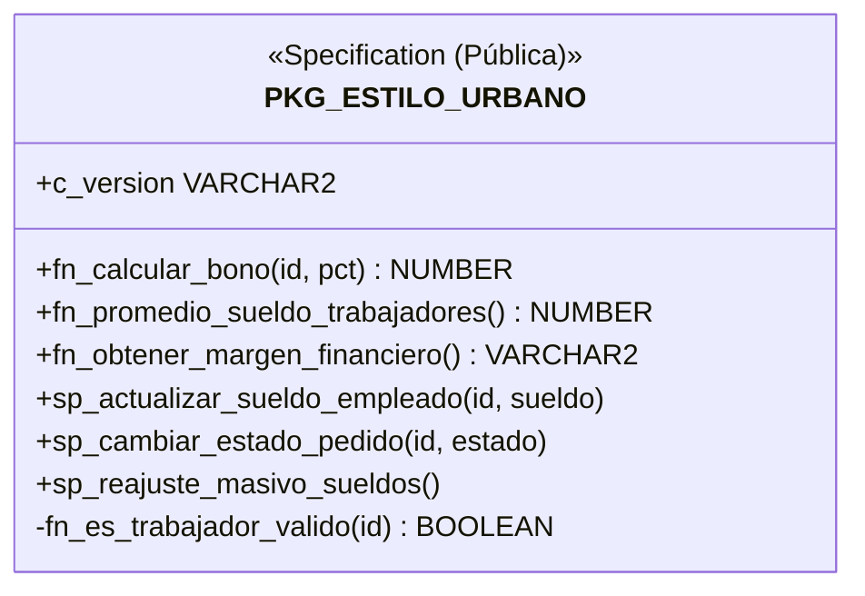
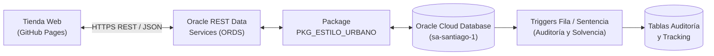

# INFORME TÉCNICO: EVALUACIÓN PARCIAL N° 2
## TALLER DE BASE DE DATOS (BDY1103)
### CASO DE ANÁLISIS SEMESTRAL: "ESTILO URBANO" (E-COMMERCE & DIGITAL FULFILLMENT)

---

**Institución:** Duoc UC  
**Carrera:** Ingeniería en Informática / Analista Programador  
**Sigla Asignatura:** BDY1103 - Taller de Base de Datos  
**Ponderación:** 40% Asignatura (Encargo: 40% | Presentación: 60%)  
**Docente:** Cristian Medina  
**Integrantes:** Eduardo Aránguiz, Luciano Zaninovic, Kevin Urbina  
**Semestre / Nivel:** Cuarto Semestre (2026)  

---

## 1. INTRODUCCIÓN

### 1.1 Descripción del Proyecto
El proyecto **"Estilo Urbano"** aborda la transformación digital de una empresa de vestuario y calzado streetwear orientada al público juvenil. En esta segunda fase de desarrollo correspondiente a la **Evaluación Parcial N° 2 (EP2)**, la solución evoluciona desde bloques anónimos hacia una **arquitectura procedural modular y robusta en Oracle Database**.

El objetivo central es automatizar integralmente la lógica de negocio, trazabilidad transaccional y cumplimiento de políticas financieras mediante:
1. **Procedimientos y Funciones Almacenadas** (con y sin parámetros) para procesamiento masivo de datos.
2. **Packages (Paquetes)** con encapsulamiento estricto mediante constructores públicos y privados.
3. **Triggers (Disparadores)** a nivel de sentencia y de fila para control de integridad, trazabilidad y auditoría de cambios.
4. **Exposición REST mediante ORDS (Oracle REST Data Services)** para conectar la tienda web en GitHub Pages directamente con la base de datos en la nube.

### 1.2 Alcance del Proyecto
El alcance de la solución desarrollada en esta etapa cubre:
* **Área de Recursos Humanos y Remuneraciones:** Auditoría estricta de cambios salariales mediante triggers con valores `:OLD` y `:NEW`, validación de sueldo mínimo legal ($500.000) y reajuste masivo inflacionario a través de procedimientos del package.
* **Área de Finanzas y Control de Gestión:** Control financiero a nivel de sentencia que salvaguarda la solvencia de la empresa, impidiendo que la nómina salarial exceda las ventas y ganancias generadas por la tienda.
* **Operaciones y Bodega (Fulfillment):** Trazabilidad automática del ciclo de vida de los pedidos (`PAGADO`, `EN_EMPAQUETAMIENTO`, `EN_CAMINO`, `ENTREGADO`) mediante disparadores reactivos que pueblan en tiempo real la tabla `HISTORIAL_TRACKING_PEDIDO`.
* **Integración Web en Tiempo Real:** Comunicación bidireccional entre la tienda online y Oracle Cloud Autonomous Database mediante endpoints REST JSON sin intermediarios.

### 1.3 Tecnologías Utilizadas
* **Motor de Base de Datos:** Oracle Autonomous Database 19c / 21c (Región: `sa-santiago-1`).
* **Lenguaje Procedural:** PL/SQL (Procedural Language for SQL).
* **Herramientas de Desarrollo:** Oracle SQL Developer v23.x / Oracle LiveSQL.
* **Capa de Servicios Web:** ORDS (Oracle REST Data Services).
* **Frontend E-Commerce:** HTML5, Tailwind CSS, JavaScript ES6 (Fetch API).

---

## 2. DESARROLLO DE PROCEDIMIENTOS Y FUNCIONES

### 2.1 Definición y Características
* **Procedimientos Almacenados (`PROCEDURE`):** Bloques de código con nombre que ejecutan secuencias de acciones o transformaciones en la base de datos (DML masivo, cálculos administrativos). No requieren retornar un valor de forma obligatoria, aunque pueden utilizar parámetros de salida (`OUT`).
* **Funciones Almacenadas (`FUNCTION`):** Subprogramas especializados diseñados para computar y retornar obligatoriamente un valor único tipado (`RETURN`). Pueden ser invocadas tanto dentro de programas PL/SQL como directamente dentro de sentencias SQL (`SELECT`, `WHERE`).

### 2.2 Ventajas y Desventajas
* **Ventajas de los Procedimientos:**
  - Reducción del tráfico de red: La lógica se compila y ejecuta directamente en el motor de base de datos.
  - Reutilización y seguridad: Permiten otorgar permisos de ejecución sobre el procedimiento sin dar acceso directo a las tablas subyacentes.
* **Desventajas de los Procedimientos:**
  - No pueden ser usados directamente como columnas en cláusulas `SELECT`.
* **Ventajas de las Funciones:**
  - Máxima flexibilidad: Permiten encapsular cálculos complejos reutilizables en consultas SQL estándar (`SELECT fn_calcular_bono(...) FROM DUAL`).
  - Determinismo y optimización en memoria caché del servidor.
* **Desventajas de las Funciones:**
  - No deben ejecutar operaciones DML (`INSERT`, `UPDATE`, `DELETE`) cuando son llamadas desde sentencias `SELECT` para evitar efectos secundarios (*side-effects*).

### 2.3 Propósito y Demostración en Estilo Urbano

#### A. Procedimiento con Parámetros: `sp_actualizar_sueldo_empleado`
Permite a la gerencia modificar el sueldo de un trabajador garantizando que sea un operador activo:
```sql
PROCEDURE sp_actualizar_sueldo_empleado(
    p_id_trabajador NUMBER,
    p_nuevo_sueldo  NUMBER
) IS
BEGIN
    IF NOT fn_es_trabajador_valido(p_id_trabajador) THEN
        DBMS_OUTPUT.PUT_LINE('AVISO: El ID ' || p_id_trabajador || ' no corresponde a un trabajador activo.');
        RETURN;
    END IF;
    UPDATE USUARIO SET sueldo_base = p_nuevo_sueldo WHERE id_usuario = p_id_trabajador;
    COMMIT;
END sp_actualizar_sueldo_empleado;
```

#### B. Procedimiento sin Parámetros: `sp_reajuste_masivo_sueldos`
Aplica un reajuste inflacionario del 4.5% a todos los operadores activos de bodega y ventas:
```sql
PROCEDURE sp_reajuste_masivo_sueldos IS
    c_pct_reajuste CONSTANT NUMBER := 0.045;
BEGIN
    UPDATE USUARIO
    SET sueldo_base = ROUND(sueldo_base * (1 + c_pct_reajuste))
    WHERE id_rol = 2 AND estado = 'A';
    COMMIT;
END sp_reajuste_masivo_sueldos;
```

#### C. Función con Parámetros: `fn_calcular_bono`
Calcula el bono de incentivo mensual en base al porcentaje de meta comercial lograda:
```sql
FUNCTION fn_calcular_bono(p_id_trabajador NUMBER, p_pct_meta NUMBER) RETURN NUMBER IS
    v_sueldo_actual NUMBER;
BEGIN
    SELECT sueldo_base INTO v_sueldo_actual FROM USUARIO WHERE id_usuario = p_id_trabajador;
    IF p_pct_meta >= 120 THEN RETURN ROUND(v_sueldo_actual * 0.12);
    ELSIF p_pct_meta >= 100 THEN RETURN ROUND(v_sueldo_actual * 0.07);
    ELSIF p_pct_meta >= 80 THEN RETURN ROUND(v_sueldo_actual * 0.03);
    ELSE RETURN 0; END IF;
END fn_calcular_bono;
```

#### D. Función sin Parámetros: `fn_promedio_sueldo_trabajadores`
Retorna el promedio de sueldos de la plantilla operativa:
```sql
FUNCTION fn_promedio_sueldo_trabajadores RETURN NUMBER IS
    v_prom NUMBER;
BEGIN
    SELECT NVL(ROUND(AVG(sueldo_base)), 0) INTO v_prom FROM USUARIO WHERE id_rol = 2 AND estado = 'A';
    RETURN v_prom;
END fn_promedio_sueldo_trabajadores;
```

---

## 3. DESARROLLO DE PACKAGES (PAQUETES)

### 3.1 Definición y Características
Un Package en PL/SQL es un contenedor estructurado que agrupa lógicamente tipos de datos, variables, constantes, cursores, excepciones, procedimientos y funciones relacionados. Se compone obligatoriamente de dos partes:
1. **Package Specification (`SPEC`):** La interfaz pública. Declara únicamente los elementos que serán visibles y consumibles por otras aplicaciones.
2. **Package Body (`BODY`):** La implementación concreta. Contiene el código fuente de los subprogramas públicos y puede definir **constructores, funciones y variables privadas** que quedan completamente ocultas al exterior.

### 3.2 Relación de Packages con Triggers
Los paquetes permiten almacenar variables de sesión y funciones auxiliares que los triggers pueden invocar para evaluar condiciones de negocio sin saturar la definición del disparador. Asimismo, permiten mitigar problemas de dependencias circulares y tablas mutantes.

### 3.3 Organización y Demostración en el Proyecto: `PKG_ESTILO_URBANO`

El package centraliza toda la lógica de sueldos, metas comerciales y estados de compras:



* **Constructor Privado (`fn_es_trabajador_valido`):** Oculto dentro del cuerpo del paquete, garantiza que ninguna operación de sueldo se aplique a clientes o usuarios inactivos.
* **Encapsulamiento:** El usuario o aplicación externa solo interactúa con los métodos autorizados en la especificación pública.

### 3.4 Vistas de Abstracción: Humanización del Modelo (`V_TRABAJADORES` y `V_CLIENTES`)
Para evitar términos robóticos o genéricos como `id_usuario` al interactuar con empleados o compradores, se implementaron dos Vistas relacionales:
* **`V_TRABAJADORES`:** Expone los campos con el identificador `id_trabajador`, permitiendo a Recursos Humanos y a la gerencia operar con semántica de negocio limpia.
* **`V_CLIENTES`:** Expone los campos con el identificador `id_cliente`, desacoplando la capa web y comercial del identificador técnico interno.

```sql
CREATE OR REPLACE VIEW V_TRABAJADORES AS
SELECT id_usuario AS id_trabajador, rut, nombre, apellido, 
       nombre || ' ' || apellido AS trabajador, email, sueldo_base
FROM USUARIO WHERE id_rol = 2;

CREATE OR REPLACE VIEW V_CLIENTES AS
SELECT id_usuario AS id_cliente, rut, nombre, apellido, 
       nombre || ' ' || apellido AS cliente, email
FROM USUARIO WHERE id_rol = 3;
```

---

## 4. DESARROLLO DE TRIGGERS (DISPARADORES)

### 4.1 Definición, Clasificación y Características
Un Trigger es un bloque PL/SQL asociado a una tabla que el motor de Oracle ejecuta de forma automática ante un evento DML (`INSERT`, `UPDATE`, `DELETE`).

Se clasifican según su momento de disparo y granularidad:
* **Nivel de Fila (`FOR EACH ROW`):** Se dispara tantas veces como filas sean afectadas por la sentencia. Proporciona acceso a los pseudorregistros `:OLD` (valor original) y `:NEW` (valor propuesto).
  - **BEFORE:** Se ejecuta antes de modificar los datos. Ideal para **validaciones preventivas** y asignación de valores por defecto.
  - **AFTER:** Se ejecuta después de la modificación. Ideal para **auditoría histórica** y cascada de datos.
* **Nivel de Sentencia (Sin `FOR EACH ROW`):** Se ejecuta una única vez por cada sentencia DML global. Es el mecanismo idóneo para **auditoría de accesos globales** y **validación de reglas financieras agregadas** (`SUM`, `AVG`), evitando el error de tabla mutante (`ORA-04091`).

### 4.2 Triggers Implementados en Estilo Urbano

#### Trigger 1 (Fila BEFORE): Validación de Sueldo Mínimo Legal
* **Tabla:** `USUARIO`
* **Evento:** `BEFORE INSERT OR UPDATE OF sueldo_base`
* **Regla:** Impide asignar sueldos menores a $500.000 a trabajadores o administradores arrojando error `ORA-20001`.

#### Trigger 2 (Fila AFTER): Auditoría Completa de Sueldos con `:OLD` y `:NEW`
* **Tabla:** `USUARIO`
* **Evento:** `AFTER UPDATE OF sueldo_base`
* **Acción:** Inserta en `AUDITORIA_SUELDO_EMPLEADO` el sueldo previo, el sueldo nuevo, la diferencia neta, el tipo de movimiento (`AUMENTO` / `DISMINUCION`), el usuario de base de datos (`USER`) y la fecha exacta (`SYSDATE`).

#### Trigger 3 (Fila AFTER): Trazabilidad Automática de Pedidos
* **Tabla:** `PEDIDO`
* **Evento:** `AFTER UPDATE OF id_estado`
* **Acción:** Ante cualquier cambio de estado en una compra, inserta de forma autónoma el nuevo hito en `HISTORIAL_TRACKING_PEDIDO`.

#### Trigger 4 (Sentencia AFTER): Auditoría DML Global
* **Tabla:** `PEDIDO`
* **Evento:** `AFTER INSERT OR UPDATE OR DELETE`
* **Acción:** Registra en `AUDITORIA_SENTENCIA_PEDIDO` cada operación masiva ejecutada en la tabla.

#### Trigger 5 (Sentencia AFTER): Control de Solvencia Financiera
* **Tabla:** `USUARIO`
* **Evento:** `AFTER INSERT OR UPDATE OF sueldo_base`
* **Regla:** Compara la nómina salarial completa `SUM(sueldo_base)` contra las ventas totales `SUM(total_pedido)`. Si los sueldos superan a los ingresos, bloquea la transacción con `ORA-20003`.

---

## 5. CONCLUSIÓN

### 5.1 Resumen de Resultados
La implementación de objetos PL/SQL en Oracle Database dota a la tienda online **"Estilo Urbano"** de un nivel empresarial de seguridad, integridad y automatización:
1. Se desacopló la lógica de negocio de la interfaz de usuario, centralizándola en la base de datos.
2. Los disparadores garantizan que ninguna modificación salarial o de tracking ocurra sin quedar auditada permanentemente.
3. El paquete `PKG_ESTILO_URBANO` asegura un mantenimiento limpio y ordenado del código.

### 5.2 Impacto del Proyecto
* **Cero ventas o modificaciones inválidas:** El sistema bloquea de raíz sueldos ilegales o pérdidas operacionales.
* **Transparencia total:** Clientes y administradores pueden auditar el historial de cada pedido y cada peso pagado a la nómina.
* **Conectividad Cloud en tiempo real:** Gracias a ORDS, la aplicación web consume directamente los datos de Oracle Autonomous Database con tiempos de respuesta sub-segundo.

### 5.3 Recomendaciones y Mejoras Futuras
* Implementar autenticación OAuth 2.0 en ORDS para roles administrativos avanzados.
* Extender el package para generación automática de liquidaciones en formato PDF desde la base de datos.

---

## 6. ANEXOS

### Anexo A: Diagrama de Arquitectura de la Solución


### Anexo B: Scripts y Archivos del Proyecto
* **`01_esquema_estilo_urbano.sql`:** DDL de tablas maestras y datos base iniciales.
* **`03_triggers_procedimientos_ep2.sql`:** Código maestro de Triggers, Tablas de Auditoría y Package.
* **`04_pruebas_y_verificacion_sql.sql`:** Batería de pruebas interactivas para comprobación de resultados.
* **`index.html`:** Tienda online con panel de monitoreo y conexión a Oracle Cloud.
