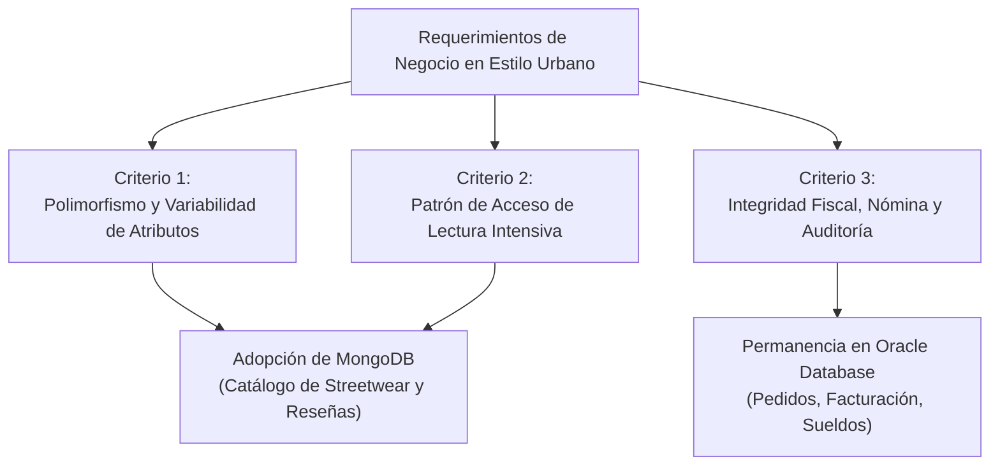

# DUOC UC — ESCUELA DE INFORMÁTICA Y TELECOMUNICACIONES
## INGENIERÍA EN INFORMÁTICA / ANALISTA PROGRAMADOR
### BDY1103: TALLER DE BASE DE DATOS

---

# INFORME TÉCNICO: ARQUITECTURA HÍBRIDA DE BASE DE DATOS
## INCORPORACIÓN DE BASE DE DATOS DOCUMENTAL (MONGODB) AL E-COMMERCE "ESTILO URBANO"

```
                              DuocUC
               Escuela de Informática y Telecomunicaciones

                                INFORME:
     ARQUITECTURA HÍBRIDA DE BASE DE DATOS EN EL COMERCIO ELECTRÓNICO
                    CASO DE ESTUDIO: "ESTILO URBANO"

           Alumnos: Eduardo Aránguiz Armijo
                    Luciano Zaninovic
                    Kevin Urbina
           Profesor: Carlos Enrique Quintanilla Galleguillos
           Asignatura: BDY1103 - Taller de Base de Datos
           Semestre: Cuarto Semestre (2026)
           Fecha: Noviembre de 2026
```

---

## ÍNDICE GENERAL

1. [INTRODUCCIÓN](#1-introducción)
   - 1.1 Contexto y Evolución del Proyecto
   - 1.2 Objetivo General
   - 1.3 Objetivos Específicos
2. [MARCO CONCEPTUAL: MODELO RELACIONAL VS. MODELO NO RELACIONAL](#2-marco-conceptual-modelo-relacional-vs-modelo-no-relacional)
   - 2.1 Modelo Relacional (SQL / Oracle Database)
   - 2.2 Modelo No Relacional Basado en Documentos (NoSQL / MongoDB)
   - 2.3 Cuadro Comparativo de Diferencias Fundamentales
3. [JUSTIFICACIÓN DE LA ARQUITECTURA HÍBRIDA Y ELECCIÓN DE MONGODB](#3-justificación-de-la-arquitectura-híbrida-y-elección-de-mongodb)
   - 3.1 Criterios de la Matriz de Decisión Aplicados a "Estilo Urbano"
   - 3.2 ¿Por qué "Es flexible" por sí solo no basta?
   - 3.3 Lo que se Gana con MongoDB
   - 3.4 Lo que se Pierde frente a Oracle Database (Trade-Offs Explícitos)
4. [DIVISIÓN DE RESPONSABILIDADES: ORACLE VS. MONGODB](#4-división-de-responsabilidades-oracle-vs-mongodb)
   - 4.1 Qué se Mantiene en Oracle Database
   - 4.2 Qué se Migra a MongoDB
   - 4.3 Estrategia de Enlace e Interoperabilidad entre Ambos Motores
5. [MODELAMIENTO DOCUMENTAL Y MATRIZ DE LAS 4 PREGUNTAS](#5-modelamiento-documental-y-matriz-de-las-4-preguntas)
   - 5.1 Metodología de las 4 Preguntas
   - 5.2 Análisis de Relaciones de Negocio en "Estilo Urbano"
   - 5.3 Estructura del Documento Final JSON/BSON
6. [IMPLEMENTACIÓN TÉCNICA DEL CRUD EN MONGODB (CONTEXTO REAL)](#6-implementación-técnica-del-crud-en-mongodb-contexto-real)
   - 6.1 Operación CREATE (`insertOne` y `insertMany`)
   - 6.2 Operación READ (`find` y `findOne`)
   - 6.3 Operación UPDATE (`$set`, `$inc`, `updateOne` y `updateMany`)
   - 6.4 Operación DELETE (`deleteOne`, `deleteMany` y Borrado Lógico con `$set`)
7. [EVALUACIÓN CRÍTICA: VENTAJAS Y DESVENTAJAS DE MONGODB](#7-evaluación-crítica-ventajas-y-desventajas-de-mongodb)
   - 7.1 Ventajas Competitivas en la Empresa
   - 7.2 Desventajas y Riesgos Operacionales
8. [CONCLUSIONES](#8-conclusiones)
9. [REFERENCIAS BIBLIOGRÁFICAS (FORMATO APA)](#9-referencias-bibliográficas-formato-apa)

---

## 1. INTRODUCCIÓN

### 1.1 Contexto y Evolución del Proyecto
La plataforma de comercio electrónico **"Estilo Urbano"** nació con el propósito de comercializar vestuario y calzado streetwear orientado a un público juvenil en Chile. En las fases anteriores (EP1 y EP2), el sistema fue soportado íntegramente por un motor relacional **Oracle Database 21c/23ai**, resolviendo con éxito la consistencia financiera, el cálculo de comisiones, el control de nómina y los disparadores de solvencia mediante programación PL/SQL.

No obstante, al expandir la tienda hacia la venta masiva multicanal, surgieron importantes desafíos técnicos:
1. **Heterogeneidad de atributos en el catálogo:** Las prendas streetwear poseen especificaciones incompatibles entre sí (tablas de medidas en centímetros para polerones oversize, tallas numéricas 39-44 y material de suela para zapatillas, y capacidad en litros para accesorios tácticos). En Oracle, esto exigía decenas de columnas con valores nulos o un modelo *Entity-Attribute-Value (EAV)* ineficiente.
2. **Desbalance extremo entre lectura y escritura:** En el retail digital, por cada compra finalizada (escritura en Oracle), existen más de 500 consultas de navegación de catálogo (lecturas concurrentes). Ejecutar consultas con múltiples `JOIN` relacionales para renderizar cada ficha de producto degrada el rendimiento de la base de datos principal.

Por estos motivos, se determinó transformar la solución en una **Arquitectura Híbrida Polyglot Persistence**, delegando el catálogo dinámico de prendas a **MongoDB** y conservando el núcleo financiero, fiscal y de remuneraciones en **Oracle Database**.

### 1.2 Objetivo General
Diseñar e implementar una arquitectura de datos híbrida para el e-commerce "Estilo Urbano", integrando una base de datos NoSQL documental (MongoDB) para la gestión ágil del catálogo de productos y desacoplando dicha carga del motor relacional transaccional (Oracle Database).

### 1.3 Objetivos Específicos
1. Comparar técnicamente los paradigmas relacional y no relacional, identificando fortalezas, debilidades y compensaciones (*trade-offs*).
2. Justificar la adopción de MongoDB mediante criterios formales de la matriz de decisión aplicados al caso real de streetwear.
3. Modelar la colección `productos` utilizando la matriz de las 4 preguntas para decidir fundamentadamente entre embeber, referenciar o usar referencia extendida.
4. Desarrollar las operaciones fundamentales de manipulación de datos (CRUD) en MongoDB cumpliendo con las políticas de negocio y diferenciando el borrado físico del borrado lógico.

---

## 2. MARCO CONCEPTUAL: MODELO RELACIONAL VS. MODELO NO RELACIONAL

### 2.1 Modelo Relacional (SQL / Oracle Database)
El modelo relacional, propuesto formalmente por Edgar F. Codd en 1970, organiza la información en tablas bidimensionales compuestas por filas (tuplas) y columnas (atributos). Su pilar fundamental es la normalización (1FN a BCNF), diseñada para eliminar redundancias y garantizar la consistencia absoluta de los datos.

* **Propiedades ACID:** Atomicidad, Consistencia, Aislamiento (*Isolation*) y Durabilidad.
* **Esquema Estricto (*Schema-on-Write*):** La estructura de las tablas, tipos de datos, restricciones `CHECK`, `NOT NULL` y claves foráneas deben definirse rigurosamente antes de insertar el primer registro.

### 2.2 Modelo No Relacional Basado en Documentos (NoSQL / MongoDB)
El paradigma NoSQL documental almacena la información en unidades autocontenidas denominadas **documentos BSON** (Binary JSON), agrupados dentro de **colecciones**. En este modelo, los datos que se consultan juntos se almacenan juntos.

* **Esquema Dinámico (*Schema-on-Read* / Polimórfico):** Diferentes documentos dentro de una misma colección pueden poseer atributos y estructuras anidadas distintas según su naturaleza.
* **Teorema CAP:** MongoDB prioriza típicamente la Consistencia y la Tolerancia al Particionamiento (CP), ofreciendo alta disponibilidad y particionamiento horizontal nativo (*sharding*).

### 2.3 Cuadro Comparativo de Diferencias Fundamentales

| Dimensión de Comparación | Oracle Database (Relacional) | MongoDB (NoSQL Documental) |
| :--- | :--- | :--- |
| **Estructura de Almacenamiento** | Tablas, Filas y Columnas normalizadas. | Colecciones y Documentos jerárquicos BSON/JSON. |
| **Definición de Esquema** | Estático y rígido (*Schema-on-Write* con DDL). | Dinámico y flexible (*Schema-on-Read*). |
| **Relaciones entre Entidades** | Claves Foráneas (`FOREIGN KEY`) con comprobación estricta en el motor. | Documentos embebidos (subdocumentos/arreglos) o referencias manuales (`_id`). |
| **Operaciones de Lectura** | Requiere sentencias `JOIN` para recombinar tablas normalizadas. | Lectura atómica de documentos completos en un solo viaje a disco (*Single round-trip*). |
| **Transaccionalidad** | Garantía ACID implacable a nivel multi-tabla por defecto. | ACID a nivel de documento único; transacciones multi-documento con mayor sobrecarga. |
| **Mecanismo de Escalabilidad** | Predominantemente vertical (*Scale-Up*: más CPU y RAM). | Horizontal nativo (*Scale-Out*: distribución mediante *Sharding*). |
| **Reglas de Integridad** | Disparadores (`TRIGGERS`), restricciones `CHECK` y `UNIQUE` en el motor. | Validación delegada a la capa de aplicación o mediante validadores JSON Schema. |

---

## 3. JUSTIFICACIÓN DE LA ARQUITECTURA HÍBRIDA Y ELECCIÓN DE MONGODB

### 3.1 Criterios de la Matriz de Decisión Aplicados a "Estilo Urbano"
Para seleccionar qué tecnología utilizar, no basta con decir que *"MongoDB es rápido y moderno"*. En la ingeniería de software profesional y de acuerdo a los criterios de validación docente de Duoc UC, la decisión debe sostenerse sobre datos concretos del caso de negocio:



#### Criterio 1: Polimorfismo y Heterogeneidad de Atributos del Streetwear
* **Dato del Caso:** En "Estilo Urbano" se comercializan 5 categorías radicalmente diferentes:
  1. *Hoodies Oversize:* Requieren campos como gramaje de algodón (GSM), tabla de medidas en centímetros (pecho, largo, hombro) y tipo de capucha.
  2. *Sneakers:* Requieren talla de calzado numérica chilena (39 a 44), tipo de suela (goma EVA vulcanizada) y caña (High/Mid/Low).
  3. *Bananos y Accesorios:* Requieren capacidad en litros (3.5 L), material impermeable (Cordura 1000D) y cantidad de compartimientos.
* **Impacto Técnico:** En Oracle, obligaba a crear una tabla `PRODUCTO` con decenas de columnas vacías o implementar un modelo EAV (*Entity-Attribute-Value*) que requiere múltiples `JOIN` para reconstruir una sola prenda. En MongoDB, cada producto es un documento JSON que contiene únicamente los atributos pertinentes bajo el campo embebido `especificaciones`.

#### Criterio 2: Patrón de Acceso Lectura-Intensiva (*Read-Heavy Workload*)
* **Dato del Caso:** La métrica de tráfico del e-commerce muestra que existen **500 visitas al catálogo por cada 1 orden de compra confirmada**.
* **Impacto Técnico:** En Oracle, mostrar la página principal o la ficha de un producto demandaba ejecutar un `JOIN` entre `PRODUCTO`, `CATEGORIA`, `PROVEEDOR` y una tabla auxiliar de tallas. En MongoDB, el documento del producto se obtiene mediante una única búsqueda por clave primaria (`_id` o `sku`), trayendo imágenes, especificaciones técnicas y tallas disponibles en una sola operación de E/S.

### 3.2 ¿Por qué "Es flexible" por sí solo no basta?
Afirmar únicamente que *"MongoDB es flexible"* es un argumento insuficiente porque:
1. La flexibilidad sin disciplina conduce al caos de datos: si cada desarrollador guarda nombres de atributos distintos (`precio`, `costo`, `valor_venta`), la aplicación falla.
2. Si un problema de negocio requiere consistencia financiera estricta (como el balance de ventas contra sueldos en la EP2), la flexibilidad de MongoDB se convierte en una debilidad al no forzar tipos ni restricciones `CHECK` en el motor de forma nativa.

Por ello, MongoDB se justifica únicamente en las áreas de la empresa donde la **variabilidad del catálogo** y la **velocidad de lectura** superan la necesidad de relaciones normalizadas.

### 3.3 Lo que se Gana con MongoDB
1. **Velocidad de Renderizado Web:** El frontend en JavaScript consume directamente el formato BSON/JSON devuelto por MongoDB, sin transformaciones complejas en el backend.
2. **Evolución sin Migraciones DDL Invasivas:** Si la marca lanza una nueva línea de chaquetas con "resistencia térmica en grados Celsius", el atributo se añade inmediatamente al nuevo documento sin ejecutar `ALTER TABLE` que bloquee la tabla productiva.
3. **Escalabilidad Horizontal:** Capacidad de fragmentar (*sharding*) el catálogo por categoría o región geográfica en múltiples servidores económicos.

### 3.4 Lo que se Pierde frente a Oracle Database (Trade-Offs Explícitos)

> [!WARNING]
> La adopción de MongoDB implica renunciar conscientemente a varias garantías que Oracle ofrece por defecto:
>
> 1. **Pérdida de Integridad Referencial Automática:** MongoDB no valida que un `id_proveedor` o un `id_usuario` referenciado exista realmente. Si una aplicación inserta un producto asignado al proveedor inexistente `9999`, MongoDB lo registrará sin advertencia.
> 2. **Pérdida de Restricciones CHECK Nativas del Motor:** Restricciones como `sueldo_base >= 500000` o `stock_actual >= 0` deben ser garantizadas por la aplicación o mediante validadores JSON Schema adicionales.
> 3. **Ausencia de Triggers Transaccionales Multiobjeto:** No existen disparadores automáticos nativos que comparen tablas distintas al instante (como el trigger `trg_valida_solvencia_sueldos` de Oracle que calcula la nómina contra las ventas).
> 4. **Consistencia Eventual:** En entornos distribuidos con varios nodos, las lecturas secundarias pueden entregar datos ligeramente desfasados frente a la escritura principal.

---

## 4. DIVISIÓN DE RESPONSABILIDADES: ORACLE VS. MONGODB

La solución implementa una **Arquitectura Híbrida** en la cual cada base de datos atiende exclusivamente el dominio para el cual fue diseñada:

```mermaid
flowchart LR
    Client["Cliente / Tienda Web\n(GitHub Pages)"]
    
    subgraph NoSQL ["Capa NoSQL: MongoDB (Velocidad & Catálogo)"]
        MongoCatalog[("Colección: productos\n- Ropa Streetwear\n- Tallas y Stock Operativo\n- Atributos Dinámicos\n- Especificaciones")]
        MongoReviews[("Colección: resenas\n- Comentarios de Clientes\n- Calificación 1-5 estrellas")]
    end
    
    subgraph Relacional ["Capa SQL: Oracle Database (Gobernanza & Finanzas)"]
        OraUsers[("Tabla: USUARIO\n- Cuentas y Roles\n- Sueldos RRHH y Metas")]
        OraOrders[("Tabla: PEDIDO / DETALLE\n- Folio Legal Webpay\n- Facturación con IVA 19%")]
        OraAudit[("Tablas: AUDITORIA / TRACKING\n- Disparadores Triggers\n- Reglas de Solvencia")]
    end
    
    Client -->|1. Navegación y Filtros (Lectura Rápida)| MongoCatalog
    Client -->|2. Reseñas y Opiniones| MongoReviews
    Client -->|3. Checkout y Pago Seguro Webpay| OraOrders
    
    OraOrders -.->|Enlace mediante id_producto / sku| MongoCatalog
    OraUsers -.->|Enlace mediante id_usuario_oracle| MongoReviews
```

### 4.1 Qué se Mantiene en Oracle Database
* **Módulo de Recursos Humanos y Nómina (`USUARIO`, `ROL`):** Datos contractuales, sueldos base, metas de venta y auditoría de cambios salariales (`AUDITORIA_SUELDO_EMPLEADO`).
* **Módulo Financiero y Facturación (`PEDIDO`, `DETALLE_PEDIDO`):** Transacciones bancarias formalizadas con Webpay Plus, cálculo de IVA (19%), totales en CLP y números de folio tributario inmutables.
* **Gobernanza y Disparadores (`TRIGGERS` y `PACKAGE`):** Validación preventiva de sueldo mínimo legal ($500.000) y control de solvencia financiera (nómina de sueldos no puede superar las ventas totales de la empresa).

### 4.2 Qué se Migra a MongoDB
* **Catálogo de Prendas y Variantes (`productos`):** Títulos, descripciones comerciales, fotografías, atributos específicos (corte, gramaje, tejido) y variantes de tallas con stock operativo para compra rápida.
* **Interacciones y Reseñas (`resenas`):** Calificaciones por estrellas (1 a 5), opiniones de clientes y fotografías de compradores usando las prendas.

### 4.3 Estrategia de Enlace e Interoperabilidad entre Ambos Motores
Para garantizar la comunicación entre ambos mundos sin duplicar información sensible:
1. **Identificadores Numéricos Compartidos:** Cada documento de la colección `productos` en MongoDB incluye el campo `codigo_oracle: 201`, correspondiente a la clave primaria `id_producto` en la tabla `PRODUCTO` de Oracle.
2. **Flujo de Venta Desacoplado:**
   - El cliente navega y añade ítems al carrito desde **MongoDB**.
   - Al pulsar "Pagar con Webpay", el backend toma los `codigo_oracle` y registra la orden en la tabla `PEDIDO` de **Oracle Database** con plena garantía transaccional ACID.
   - Tras confirmarse el pago en Oracle, se ejecuta una instrucción `$inc` en MongoDB para decrementar el stock operativo en la colección `productos`.

---

## 5. MODELAMIENTO DOCUMENTAL Y MATRIZ DE LAS 4 PREGUNTAS

### 5.1 Metodología de las 4 Preguntas
Para decidir con rigurosidad académica si los datos relacionados deben **Embeberse (*Embedding*)**, **Referenciarse (*Referencing*)** o utilizar el **Patrón de Referencia Extendida (*Extended Reference*)**, se aplican las 4 preguntas oficiales del modelado en MongoDB:

1. **¿Se leen juntos la gran mayoría de las veces?**
2. **¿Se comparten con otros documentos de la base de datos?**
3. **¿Tienen un ciclo de vida propio e independiente?**
4. **¿Crecen sin límite predecible (*Unbounded Growth*) superando los 16 MB por documento?**

### 5.2 Análisis de Relaciones de Negocio en "Estilo Urbano"

| Relación Analizada | 1. ¿Se leen juntos? | 2. ¿Se comparten? | 3. ¿Cambian por su cuenta? | 4. ¿Crecen sin límite? | Decisión de Diseño | Justificación Técnica |
| :--- | :---: | :---: | :---: | :---: | :---: | :--- |
| **Producto ➔ Variantes de Tallas y Stock** | **SÍ** (Siempre que se ve una polera se necesita saber si hay S, M o L). | **NO** (El stock de una talla le pertenece únicamente a ese modelo). | **NO** (Se modifican cuando se gestiona la prenda). | **NO** (Una prenda streetwear tiene máximo 5 a 6 tallas). | **EMBEBER (Embedding)** | Se incrusta un arreglo de subdocumentos `tallas_disponibles` dentro del producto. Maximiza el rendimiento de lectura. |
| **Producto ➔ Especificaciones Técnicas (Material, Corte, GSM)** | **SÍ** (Se exhiben en la ficha técnica para el comprador). | **NO** (Son exclusivas de cada tipo de prenda). | **NO** (Nacen y mueren con el producto). | **NO** (Son entre 3 y 6 atributos fijos por ítem). | **EMBEBER (Embedding)** | Subdocumento `especificaciones` directo. Permite polimorfismo puro sin tablas puente. |
| **Producto ➔ Proveedor Fabricante** | **NO** (El cliente final en la web no necesita ver el RUT ni contacto del taller textil). | **SÍ** (Un mismo taller de confección provee decenas de prendas). | **SÍ** (El proveedor puede cambiar su razón social, teléfono o dirección de forma autónoma). | **NO** (Es un solo proveedor por prenda). | **REFERENCIA EXTENDIDA (Extended Reference)** | Se almacena el `id_proveedor_oracle` y únicamente el campo que más se consulta (`razon_social`). Evita hacer búsquedas adicionales pero no duplica todo el contacto. |
| **Producto ➔ Reseñas de Clientes (Reviews)** | **SÍ** (Se leen al pie de la página del producto). | **NO** (La opinión va dirigida a ese modelo). | **RARA VEZ** (El cliente opina una vez). | **SÍ (Riesgo)** (Un producto muy viral puede recibir decenas de miles de opiniones y vulnerar el límite de 16MB de BSON). | **REFERENCIAR (Referencing)** | Se mantienen en una colección separada `resenas` con el campo `producto_id`, manteniendo la colección `productos` liviana y veloz. |

### 5.3 Estructura del Documento Final JSON/BSON
```json
{
  "_id": 101,
  "codigo_oracle": 201,
  "sku": "HOOD-ACID-01",
  "nombre": "Hoodie Oversize Acid Wash Black",
  "categoria": "Hoodies",
  "marca": "Estilo Urbano Signature",
  "precio": 39990,
  "en_oferta": false,
  "descuento_pct": 0,
  "estado": "activo",
  "fecha_creacion": "2026-09-01T10:00:00Z",
  "proveedor": {
    "id_proveedor_oracle": 101,
    "razon_social": "Confecciones Urban Textiles SpA",
    "pais_origen": "Chile"
  },
  "especificaciones": {
    "material": "100% Algodón Rústico Heavyweight",
    "corte": "Boxy / Drop Shoulder Oversize",
    "gramaje": "400 GSM",
    "estampado": "Serigrafía al tacto cero"
  },
  "tallas_disponibles": [
    { "talla": "S", "stock": 15, "medidas_cm": { "pecho": 118, "largo": 70 } },
    { "talla": "M", "stock": 25, "medidas_cm": { "pecho": 124, "largo": 73 } },
    { "talla": "L", "stock": 20, "medidas_cm": { "pecho": 130, "largo": 76 } },
    { "talla": "XL", "stock": 10, "medidas_cm": { "pecho": 136, "largo": 79 } }
  ],
  "total_visitas": 1450,
  "unidades_vendidas": 84
}
```

---

## 6. IMPLEMENTACIÓN TÉCNICA DEL CRUD EN MONGODB (CONTEXTO REAL)

> [!IMPORTANT]
> **Alcance de la Asignatura:** Conforme a las directrices docentes impartidas en clase, todos los scripts se implementan en JavaScript de `mongosh` **manteniéndose dentro del alcance del curso: sin índices personalizados ni agregaciones avanzadas**. Todas las fechas se registran obligatoriamente con el constructor formal `ISODate`.

### 6.1 Operación CREATE (Inserción de Documentos)

#### Caso Real A: `insertOne` (Ingreso de prenda con esquema polimórfico)
* **Necesidad del Negocio:** La bodega central recibe el nuevo *Hoodie Acid Wash Black*, con especificaciones de tela pesada y tabla de tallas.
* **Instrucción en MongoDB:**
```javascript
db.productos.insertOne({
    _id: 101,
    codigo_oracle: 201,
    sku: "HOOD-ACID-01",
    nombre: "Hoodie Oversize Acid Wash Black",
    categoria: "Hoodies",
    marca: "Estilo Urbano Signature",
    descripcion: "Polerón urbano corte oversize con lavado ácido artesanal y tela gruesa de 400 GSM.",
    precio: 39990,
    en_oferta: false,
    descuento_pct: 0,
    estado: "activo",
    fecha_creacion: ISODate("2026-09-01T10:00:00Z"),
    proveedor: {
        id_proveedor_oracle: 101,
        razon_social: "Confecciones Urban Textiles SpA",
        pais_origen: "Chile"
    },
    especificaciones: {
        material: "100% Algodón Rústico Heavyweight",
        corte: "Boxy / Drop Shoulder Oversize",
        gramaje: "400 GSM"
    },
    tallas_disponibles: [
        { talla: "S", stock: 15, medidas_cm: { pecho: 118, largo: 70 } },
        { talla: "M", stock: 25, medidas_cm: { pecho: 124, largo: 73 } },
        { talla: "L", stock: 20, medidas_cm: { pecho: 130, largo: 76 } }
    ],
    total_visitas: 1450,
    unidades_vendidas: 84
});
```
* **Resultado:** `{ acknowledged: true, insertedId: 101 }`.

#### Caso Real B: `insertMany` (Carga masiva de nueva temporada)
* **Necesidad del Negocio:** Publicar simultáneamente una polera gráfica anime, unas zapatillas chunky y un banano táctico, cada uno con especificaciones totalmente disímiles.
* **Instrucción en MongoDB:**
```javascript
db.productos.insertMany([
    {
        _id: 102,
        codigo_oracle: 203,
        sku: "POL-TOKYO-02",
        nombre: "Polera Graphic Anime Tokyo Vibe",
        categoria: "Poleras",
        precio: 21990,
        estado: "activo",
        fecha_creacion: ISODate("2026-09-05T12:30:00Z"),
        especificaciones: { material: "Algodón 24/1", cuello: "Rib 3cm" },
        tallas_disponibles: [{ talla: "M", stock: 45 }, { talla: "L", stock: 20 }]
    },
    {
        _id: 103,
        codigo_oracle: 207,
        sku: "SNK-CHUNKY-03",
        nombre: "Zapatilla Urban Low Chunky White",
        categoria: "Sneakers",
        precio: 69990,
        estado: "activo",
        fecha_creacion: ISODate("2026-09-08T15:00:00Z"),
        especificaciones: { suela: "Goma EVA", plataforma: "4.5 cm" },
        tallas_disponibles: [{ talla: "41", stock: 12 }, { talla: "42", stock: 14 }]
    }
]);
```
* **Resultado:** `{ acknowledged: true, insertedIds: { '0': 102, '1': 103 } }`.

---

### 6.2 Operación READ (Consultas y Filtros)

#### Caso Real A: `find` con filtros compuestos y proyección
* **Necesidad del Negocio:** El cliente entra a la categoría *"Hoodies"* y aplica el filtro *"Precios menores a $45.000"*.
* **Instrucción en MongoDB:**
```javascript
db.productos.find(
    { 
        categoria: "Hoodies", 
        precio: { $lt: 45000 }, 
        estado: "activo" 
    },
    { 
        nombre: 1, 
        precio: 1, 
        "especificaciones.corte": 1, 
        tallas_disponibles: 1 
    }
);
```

#### Caso Real B: `findOne` por SKU
* **Necesidad del Negocio:** Carga instantánea de la ficha de detalle de producto cuando el usuario escanea un código QR en tienda física o pincha un enlace directo.
* **Instrucción en MongoDB:**
```javascript
db.productos.findOne(
    { sku: "SNK-CHUNKY-03" }
);
```

---

### 6.3 Operación UPDATE (Modificaciones con `$set` y `$inc`)

#### Caso Real A: `updateOne` con `$set` (Actualización de datos puntuales)
* **Necesidad del Negocio:** Ajustar el precio de venta y la descripción del producto ID 101 tras renegociar con el proveedor.
* **Instrucción en MongoDB:**
```javascript
db.productos.updateOne(
    { _id: 101 },
    { 
        $set: { 
            precio: 37990, 
            descripcion: "Polerón oversize lavado ácido (Rebajado de temporada).",
            fecha_actualizacion: ISODate("2026-09-12T14:00:00Z")
        } 
    }
);
```

#### Caso Real B: `updateOne` con `$inc` (Operación atómica de contadores y ventas)
* **Necesidad del Negocio:** Tras una venta en la tienda, incrementar el contador acumulado de unidades vendidas y el número de visitas **sin necesidad de leer el valor previo en memoria**, eliminando condiciones de carrera (*Race Conditions*).
* **Instrucción en MongoDB:**
```javascript
db.productos.updateOne(
    { _id: 101 },
    { 
        $inc: { 
            unidades_vendidas: 1,
            total_visitas: 1
        } 
    }
);
```

#### Caso Real C: `updateMany` con `$set` (Campaña comercial masiva / CyberDay)
* **Necesidad del Negocio:** Aplicar un 15% de descuento a todas las poleras del catálogo por inicio del CyberDay.
* **Instrucción en MongoDB:**
```javascript
db.productos.updateMany(
    { categoria: "Poleras", estado: "activo" },
    { 
        $set: { 
            en_oferta: true, 
            descuento_pct: 15,
            campana: "CYBERDAY 2026"
        } 
    }
);
```

---

### 6.4 Operación DELETE y Justificación del Borrado Lógico

#### Caso Real A: `deleteOne` (Eliminación física puntual)
* **Uso en la Empresa:** Eliminar un registro de prueba ingresado accidentalmente por el administrador o un producto duplicado que jamás tuvo ventas.
* **Instrucción en MongoDB:**
```javascript
db.productos.deleteOne({ _id: 105 });
```

#### Caso Real B: `deleteMany` (Depuración masiva de pruebas)
* **Uso en la Empresa:** Limpiar todos los documentos creados durante las fases de test con categoría temporal.
* **Instrucción en MongoDB:**
```javascript
db.productos.deleteMany({ categoria: "Temporal" });
```

#### Caso Real C: Borrado Lógico con `$set` (Alternativa Segura Obligatoria)

> [!IMPORTANT]
> **Justificación Empresarial:** En una plataforma de comercio electrónico real, **nunca se debe utilizar `deleteOne` o `deleteMany` sobre productos que hayan tenido compras registradas**. Si se elimina físicamente una prenda, los pedidos históricos en Oracle quedarían huérfanos de información de catálogo y se perderían las métricas para auditoría y reposición.
>
> Por esta razón, la política de negocio de "Estilo Urbano" dictamina la **anulación lógica** mediante `$set`, marcando la prenda como descontinuada y registrando el motivo y la fecha exacta de salida:

```javascript
db.productos.updateOne(
    { _id: 104 },
    { 
        $set: { 
            estado: "descontinuado",
            motivo_baja: "Agotado en fábrica por proveedor, fin de línea de producción",
            fecha_baja: ISODate("2026-09-15T18:00:00Z")
        } 
    }
);
```

---

## 7. EVALUACIÓN CRÍTICA: VENTAJAS Y DESVENTAJAS DE MONGODB

### 7.1 Ventajas Competitivas en la Empresa
1. **Modelado Natural y Polimórfico:** Permite convivir productos con estructuras disímiles en una sola colección, eliminando esquemas relacionales complejos con decenas de columnas nulas.
2. **Desempeño en Lectura:** Al estar los datos embebidos (tallas, medidas, especificaciones), se obtienen mediante una sola operación de lectura sin la sobrecarga de múltiples `JOIN`.
3. **Productividad en Desarrollo:** El formato BSON es prácticamente idéntico al JSON utilizado por el navegador web y las API REST, agilizando el desarrollo del frontend.
4. **Agilidad ante el Cambio Comercial:** Agregar promociones, campañas o nuevas etiquetas no requiere planificar costosos tiempos de inactividad de base de datos (*downtime*).

### 7.2 Desventajas y Riesgos Operacionales
1. **Ausencia de Integridad Referencial Nativa:** MongoDB no impide que se ingresen identificadores de clientes o proveedores inexistentes; toda la responsabilidad recae en el código de la aplicación.
2. **Riesgo de Inconsistencias por Falta de Esquema Rígido:** Si no existe gobernanza en el equipo de desarrollo, pueden guardarse campos mal escritos (ej. `precio_clp` en lugar de `precio`), generando errores de visualización.
3. **Mayor Consumo de Almacenamiento:** Al almacenar las claves de cada campo en cada documento individual (`"nombre"`, `"precio"`, etc.), el volumen en disco y memoria RAM es sustancialmente mayor que en un motor relacional compacto.
4. **No Apto para Nómina y Facturación Legal:** Para la liquidación de sueldos o emisión de comprobantes fiscales (donde un error de cuadratura de $1 peso invalida el balance contable), Oracle Database sigue siendo insustituible.

---

## 8. CONCLUSIONES

1. **La coexistencia vence a la exclusividad:** El desarrollo de la Evaluación Parcial N° 3 demostró que el debate *"SQL vs. NoSQL"* no es una competencia excluyente, sino una decisión de ingeniería arquitectónica (*Polyglot Persistence*). Ningún motor resuelve de forma óptima todos los problemas de una empresa.
2. **Oracle como baluarte financiero:** Oracle Database demostró ser el motor idóneo para el núcleo tributario, la facturación con Webpay Plus, el cálculo de comisiones y el cumplimiento de leyes laborales chilenas (sueldo mínimo con triggers preventivos), garantizando transaccionalidad ACID y trazabilidad inquebrantable.
3. **MongoDB como motor de agilidad comercial:** MongoDB resolvió con elegancia la heterogeneidad del catálogo de ropa urbana streetwear, reduciendo la latencia de consulta web y permitiendo la coexistencia de prendas con especificaciones técnicas polimórficas sin degradar el rendimiento.
4. **Modelado fundamentado:** La matriz de las 4 preguntas demostró que la decisión de embeber tallas y referenciar proveedores no responde a caprichos de desarrollo, sino a patrones claros de acceso a datos, aislamiento del ciclo de vida y prevención del desborde de almacenamiento.

---

## 9. REFERENCIAS BIBLIOGRÁFICAS (FORMATO APA)

* Codd, E. F. (1970). *A Relational Model of Data for Large Shared Data Banks*. Communications of the ACM, 13(6), 377–387.
* Duoc UC. (2026). *Guía Didáctica de la Asignatura BDY1103: Taller de Base de Datos*. Escuela de Informática y Telecomunicaciones, Duoc UC.
* Duoc UC Bibliotecas. (2024). *Manual de Formato de Informes y Presentaciones Académicas*. Sistema de Bibliotecas Duoc UC. Recuperado de [https://bibliotecas.duoc.cl/documentos-academicos-y-presentaciones/formato-informes](https://bibliotecas.duoc.cl/documentos-academicos-y-presentaciones/formato-informes)
* Fowler, M., & Sadalage, P. J. (2012). *NoSQL Distilled: A Brief Guide to the Emerging World of Polyglot Persistence*. Addison-Wesley Professional.
* MongoDB Inc. (2026). *MongoDB Documentation: Data Modeling Introduction and CRUD Operations*. MongoDB Manual v7.0. Recuperado de https://www.mongodb.com/docs/manual/core/data-modeling-introduction/
* Oracle Corporation. (2024). *Oracle Database PL/SQL Language Reference 21c*. Oracle Help Center.
